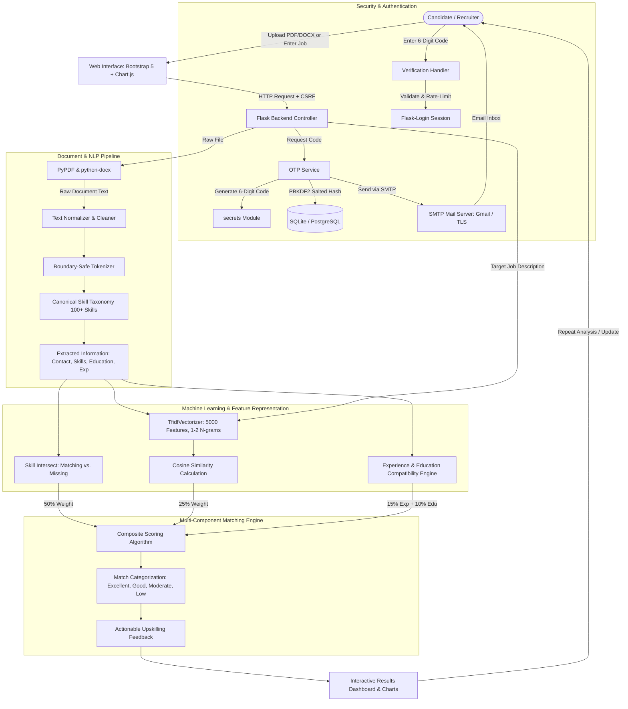

# JobHelper — AI Resume Analyzer, Job Matcher & Career Assistant

[](https://www.python.org/)
[](https://flask.palletsprojects.com/)
[](https://scikit-learn.org/)
[-brightgreen.svg)]()
[]()

> **Final-Year Academic Capstone Project**  
> An automated, production-style recruitment assistance platform powered by Natural Language Processing (NLP), Machine Learning (TF-IDF Cosine Similarity), and explainable multi-component matching algorithms.

---

## 1. Project Introduction & Problem Statement

### Problem Statement
Traditional human resources recruitment and campus placements require reviewers to manually inspect hundreds of resumes and compare them against lengthy job descriptions. This manual process is:
- **Time-Consuming & Inefficient**: HR teams spend an average of only 6 to 7 seconds per initial glance, often missing qualified candidates.
- **Subjective & Inconsistent**: Keyword mismatches occur due to terminology variations (e.g., `Node.js` vs. `NodeJS`, `PostgreSQL` vs. `Postgres`).
- **Opaque**: Candidates rarely receive explainable feedback on why their resume was rejected or which specific skills they were missing.

### Project Objective
**JobHelper** bridges this gap by creating an explainable, automated, and secure end-to-end recruitment intelligence system:
1. **Passwordless Real Email OTP Verification**: Cryptographically secure 6-digit one-time code delivery via SMTP with PBKDF2 salted hashing.
2. **Multi-Format Resume Text Extraction**: Automatic parsing of PDF and DOCX files with scanned document detection.
3. **Canonical Skill Taxonomy Matching**: Regex and NLP rule-based extraction covering 100+ programming languages, frameworks, cloud tools, databases, and soft skills.
4. **Scikit-learn TF-IDF & Cosine Similarity**: Mathematical vectorization of document semantics beyond simple keyword counts.
5. **Explainable Multi-Component Job Matching**: Weighted composite scoring (Skills 50%, TF-IDF 25%, Experience 15%, Education 10%).
6. **Missing Skill Detection & Actionable Guidance**: Pinpoints exact prerequisite gaps and provides targeted upskilling advice.
7. **Resume Quality Auditor**: 100-point transparent quality assessment evaluating quantifiable metrics and active verbs.
8. **Built-in Resume Builder & Portfolio Generator**: Generates clean vector PDF resumes using ReportLab and production-ready HTML5/CSS3/JS website ZIP packages.

---

## 2. System Architecture

The following Mermaid diagram illustrates the complete architectural data pipeline:



---

## 3. Technology Stack

| Layer | Technologies | Rationale / Purpose |
| :--- | :--- | :--- |
| **Backend Framework** | Python 3, Flask 3.1, Werkzeug | Modular blueprint architecture, lightweight, asynchronous capability |
| **ORM & Database** | SQLAlchemy 2.1, SQLite, PostgreSQL compatible | Secure parameterized queries, migration ready, cross-platform |
| **Authentication** | Flask-Login, Flask-WTF (CSRF), `secrets`, PBKDF2 | Zero plaintext credential storage, real email OTP dispatch |
| **NLP & Text Processing** | Regex, rule-based lemmatization, stopword filtering | Deterministic boundary detection, zero heavy external download overhead |
| **Machine Learning** | Scikit-learn (`TfidfVectorizer`, `cosine_similarity`), NumPy, Pandas | Mathematical document vectorization and term overlap scoring |
| **Document Parsing** | PyPDF 7.1, python-docx 1.2 | Multi-page text extraction, table parsing, scanned document limitations |
| **PDF Generation** | ReportLab 5.1 | Pixel-perfect vector PDF compilation across 3 templates |
| **Frontend UI** | HTML5, CSS3, JavaScript, Bootstrap 5.3, Chart.js 4.4 | Modern SaaS dark/light palette, responsive mobile navigation, interactive charts |

---

## 4. Machine Learning & Matching Methodology

The matching algorithm computes an explainable, normalized score between **0.0% and 100.0%**:

$$\text{Final Score} = (S \times 0.50) + (T \times 0.25) + (E \times 0.15) + (D \times 0.10)$$

Where:
- **$S$ (Skills Compatibility — 50%)**: Ratio of required job skills matched by the candidate's verified skills, plus a capped bonus (+3% per skill) for matching preferred/nice-to-have skills:
  $$S = \min\left(100, \left(\frac{|\text{Matching Skills}|}{|\text{Required Skills}|} + \text{Bonus}\right) \times 100\right)$$
- **$T$ (TF-IDF Cosine Similarity — 25%)**: Cosine angle between L2-normalized TF-IDF vectors of the preprocessed resume text and job description:
  $$\text{Cosine Similarity}(\vec{u}, \vec{v}) = \frac{\vec{u} \cdot \vec{v}}{\|\vec{u}\|_2 \|\vec{v}\|_2}$$
  - Evaluated using n-grams `(1, 2)` to capture phrases like *"machine learning"*, *"spring boot"*, *"rest api"*.
- **$E$ (Experience Alignment — 15%)**: Heuristic comparison between candidate's extracted years of experience and stated job expectations.
- **$D$ (Education Compatibility — 10%)**: Degree hierarchy ranking (Doctorate $\ge$ Master's $\ge$ Bachelor's $\ge$ Associate/Diploma).

### Match Tiers
- **$\ge 80\%$**: *Excellent Match* (Green badge — Immediate interview recommended)
- **$65\% - 79\%$**: *Good Match* (Blue badge — Strong candidate with minor skill gaps)
- **$45\% - 64\%$**: *Moderate Match* (Orange badge — Partial alignment; upskilling required)
- **$< 45\%$**: *Low Match* (Red badge — Significant skills and background divergence)

---

## 5. Database Schema

The database model is defined via SQLAlchemy in `app/models.py`:

```
User (id, name, email [indexed, unique], email_verified, created_at)
  ├── UserProfile (id, user_id [FK], full_name, phone, headline, location, bio, education, experience)
  ├── OTPVerification (id, user_id [FK], email, otp_hash, expires_at, attempts, resend_available_at, used)
  ├── Resume (id, user_id [FK], original_filename, stored_filename, file_type, file_size_bytes, extracted_text, extracted_information [JSON], quality_score, uploaded_at)
  │     └── Analysis (id, user_id [FK], resume_id [FK], job_id [FK], overall_score, skills_score, text_similarity, experience_score, education_score, matching_skills [JSON], missing_skills [JSON], recommendations [JSON], created_at)
  ├── Job (id, user_id [FK, nullable], title, company, description, required_skills, preferred_skills, experience, location, employment_type, is_sample, created_at)
  └── SavedJob (id, user_id [FK], job_id [FK], created_at)
```

---

## 6. Email OTP Authentication Security

1. **Random Generation**: Cryptographically uniform 6-digit code via `secrets.randbelow(900000) + 100000`.
2. **PBKDF2 Salted Hashing**: The plaintext code is hashed immediately with Werkzeug's secure salt derivation and stored in `otp_verifications.otp_hash`. Plaintext codes are **never** logged, written to disk, or displayed in the frontend.
3. **5-Minute Expiry**: Records automatically expire after 300 seconds.
4. **Single-Use Invalidation**: A code is permanently marked `used=True` immediately upon a successful login or upon reaching max attempts.
5. **Rate Limiting & Cooldown**: A strict 60-second cooldown is enforced between OTP requests to prevent spam and abuse.
6. **Attempt Limit**: Maximum 5 attempts allowed per code before automatic invalidation.
7. **SMTP Configuration Check**: If SMTP credentials are absent from `.env`, the system presents a clear diagnostic alert rather than falsely reporting an email was sent.

---

## 7. Installation & Quickstart

### Prerequisites
- Python 3.10, 3.11, 3.12, 3.13, or 3.14
- Git

### Step 1: Clone or Navigate to the Project
```bash
cd "job helper ai"
```

### Step 2: Create and Activate Virtual Environment
```bash
python3 -m venv .venv
source .venv/bin/activate  # On Windows: .venv\Scripts\activate
```

### Step 3: Install Required Dependencies
```bash
pip install -r requirements.txt
```

### Step 4: Configure Environment Variables
Copy `.env.example` to `.env`:
```bash
cp .env.example .env
```
Open `.env` and configure your settings:
```env
SECRET_KEY=generate-a-strong-random-key
FLASK_ENV=development
DATABASE_URL=sqlite:///jobhelper.db

# Real Email OTP Configuration (Gmail SMTP example)
SMTP_HOST=smtp.gmail.com
SMTP_PORT=587
SMTP_USE_TLS=True
SMTP_USERNAME=your-email@gmail.com
SMTP_PASSWORD=your-16-character-app-password
MAIL_DEFAULT_SENDER="JobHelper AI" <your-email@gmail.com>
```

> **Gmail App Password Setup Note**:  
> 1. In your Google Account, enable **2-Step Verification**.  
> 2. Search for **App passwords** in your Google Security settings.  
> 3. Generate a 16-character password and paste it into `SMTP_PASSWORD`.

### Step 5: Start the Application
```bash
python run.py
```
Open your browser at:  
👉 **http://127.0.0.1:5001**

---

## 8. Running Automated Tests

JobHelper includes a complete automated test suite testing auth, NLP, TF-IDF, resume parsing, and end-to-end integration journeys:

```bash
.venv/bin/pytest tests/ -v
```

Expected output:
```text
tests/test_auth.py::test_otp_generation PASSED
tests/test_auth.py::test_otp_hashing PASSED
tests/test_auth.py::test_otp_verification_success PASSED
tests/test_auth.py::test_otp_invalid_code PASSED
tests/test_auth.py::test_otp_expiration PASSED
tests/test_auth.py::test_otp_reuse_prevention PASSED
tests/test_nlp_ml.py::test_text_cleaning_and_tokenization PASSED
tests/test_nlp_ml.py::test_skill_extraction PASSED
tests/test_nlp_ml.py::test_tfidf_cosine_similarity PASSED
tests/test_nlp_ml.py::test_matching_algorithm_scoring PASSED
tests/test_nlp_ml.py::test_experience_and_education_detection PASSED
tests/test_resume_parser.py::test_pdf_resume_parsing PASSED
tests/test_resume_parser.py::test_docx_resume_parsing PASSED
tests/test_resume_parser.py::test_invalid_scanned_pdf_handling PASSED
tests/test_user_journey.py::test_complete_user_journey PASSED

======================== 15 passed in 1.54s ========================
```

---

## 9. Project Directory Structure

```text
jobhelper/
├── app/
│   ├── __init__.py               # Flask app factory, error handlers, seeds
│   ├── extensions.py             # db, login_manager, csrf instances
│   ├── models.py                 # User, OTP, Resume, Job, Analysis models
│   ├── auth/
│   │   ├── __init__.py
│   │   ├── routes.py             # Login, verify-otp, resend, profile setup
│   │   ├── services.py           # OTP generation, PBKDF2 hashing, SMTP sender
│   │   └── forms.py              # WTForms with CSRF protection
│   ├── dashboard/
│   │   ├── __init__.py
│   │   └── routes.py             # Analytics, DB stats, skill distribution
│   ├── resume/
│   │   ├── __init__.py
│   │   ├── routes.py             # Upload, view, edit, quality audit, delete
│   │   ├── parser.py             # PyPDF & python-docx extractors
│   │   ├── extractor.py          # Regex & heuristic entity extraction
│   │   └── analyzer.py           # 100-pt multi-dimensional quality auditor
│   ├── jobs/
│   │   ├── __init__.py
│   │   ├── routes.py             # Browse, add job, match, recommendations, history
│   │   ├── recommender.py        # Ranked recommendation engine with filters
│   │   └── sample_jobs.py        # 8 realistic industry sample job postings
│   ├── ml/
│   │   ├── __init__.py
│   │   ├── preprocessing.py      # Normalization, tokenization, lemmatization
│   │   ├── skill_extraction.py   # Canonical taxonomy (100+ skills + aliases)
│   │   ├── feature_extraction.py # Scikit-learn TF-IDF vectorizer & cosine similarity
│   │   ├── matching.py           # Weighted composite matching algorithm
│   │   └── evaluation.py         # Precision, recall, and F1 benchmarks
│   ├── resume_builder/
│   │   ├── __init__.py
│   │   ├── routes.py             # Interactive form, live preview, PDF stream
│   │   └── generator.py          # ReportLab PDF engine (Modern, Classic, Minimalist)
│   ├── portfolio/
│   │   ├── __init__.py
│   │   ├── routes.py             # Theme selection, live iframe preview, ZIP export
│   │   └── generator.py          # HTML5/CSS3/JS bundle generator & ZIP archiver
│   ├── templates/                # Jinja2 responsive templates (Bootstrap 5)
│   │   ├── base.html
│   │   ├── landing.html
│   │   ├── auth/
│   │   ├── dashboard/
│   │   ├── resume/
│   │   ├── jobs/
│   │   ├── builder/
│   │   ├── portfolio/
│   │   └── errors/
│   └── static/
│       ├── css/custom.css        # SaaS design tokens, card styles, gauges
│       ├── js/main.js            # Dropzone, dynamic builder rows, sidebar
│       └── uploads/              # Secure user upload storage
├── tests/                        # 15 comprehensive unit & integration tests
├── config.py                     # Development, Testing, Production configs
├── run.py                        # Local execution script (port 5001)
├── requirements.txt              # Pinned python dependencies
├── .env.example                  # Environment variable reference
└── README.md                     # Academic capstone documentation
```

---

## 10. Demonstration Guide for College Faculty

To present this capstone project effectively:
1. **Showcase the Landing Page**: Walk through the system architecture diagram and feature capabilities.
2. **Demonstrate Real Email OTP**: Enter a real email, demonstrate the responsive HTML email template received in your inbox with expiration details, and show attempt limits.
3. **Showcase Resume Extraction**: Upload a PDF or DOCX file; point out how skills are mapped to canonical categories and extracted without hallucination.
4. **Demonstrate Job Matching**:
   - Compare the resume against the pre-seeded "Python Developer" or "Machine Learning Engineer" jobs.
   - Explain the 4-component scoring model: Skills (50%), TF-IDF (25%), Experience (15%), Education (10%).
   - Highlight the **Missing Skills** panel and explain how actionable upskilling guidance is provided.
5. **Explore Job Recommendations**: Filter sample jobs by minimum compatibility threshold.
6. **Demonstrate Resume Builder**: Show dynamic row addition and download the compiled ReportLab PDF.
7. **Demonstrate Portfolio Generator**: Show live theme switching (Dark Tech, Clean Light, Gradient) and download the live ZIP file.
8. **Show Automated Test Suite**: Run `pytest tests/ -v` to prove all 15 unit and integration tests pass cleanly.

---

## 11. Limitations & Future Roadmap

### Current Limitations
- Scanned PDF resumes without an embedded text layer require an OCR text layer (e.g. Tesseract) before processing.
- Experience calculations rely on explicit years mentioned in text headers rather than exhaustive date range parsing across non-standard formats.

### Future Roadmap
- Fine-tuned domain embeddings (`sentence-transformers/all-MiniLM-L6-v2`) for semantic matching alongside TF-IDF.
- Direct LinkedIn API integration for one-click job posting synchronization.
- Voice-assisted mock interview questions generated dynamically from identified missing skills.

---

## 12. License
This academic project is open-source under the [MIT License](LICENSE).
